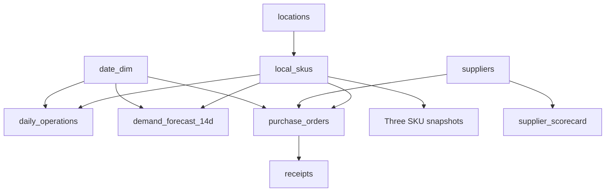

# Power BI semantic model — Phase 9

The data package is generated by `python src/prepare_phase9.py`; `data/` contains byte-identical copies of approved upstream CSVs plus a derived calendar. See `phase9_validation.json` for SHA-256 and row counts. No Power BI report has been executed in this environment.

## Grain and lineage

| Table | Key / grain | Role | Origin |
| --- | --- | --- | --- |
| locations | location_id; 5 locations | dimension | Published synthetic source ID/region, derived label |
| local_skus | local_sku_id; 100 location-product pairs | dimension | Published synthetic source IDs/category, derived local key |
| date_dim | date; one day, 2022-01-01–2024-02-13 | dimension | DERIVED calendar |
| suppliers | supplier_id; six | dimension | SIMULATED |
| daily_operations | date + local_sku_id; 76,000 | historical fact | Published synthetic source + derived attributes |
| demand_forecast_14d | forecast_date + local_sku_id; 1,400 | future fact | DERIVED Ridge forecast |
| forecast_holdout_predictions | origin_date + forecast_date + local_sku_id; 14,000 | backtest fact | DERIVED model evaluation; test split only for test KPI |
| purchase_orders | po_id; 5,299 | procurement fact | SIMULATED |
| receipts | receipt_id; one receipt per po_id; 5,299 | receipt detail | SIMULATED |
| replenishment_recommendations | local_sku_id at one snapshot; 100 | inventory policy fact | source snapshot + forecast + simulated costs/lead times + assumed policy |
| abc_inventory_classification | local_sku_id; 100 | 2023 analytical snapshot | DERIVED 2023 sales-value proxy |
| supplier_scorecard | supplier_id; six | scenario aggregate | SIMULATED events; DERIVED relative scores with assumed weights |
| supply_chain_priority_matrix | local_sku_id; 100 | current action snapshot | MIXED; derived decision rule |
| sku_demand_profile | local_sku_id; 100 | historical summary | DERIVED source-based variability |

Use `local_sku_id`, not `original_product_id`, for SKU relationships. Keep table names exactly as filenames without `.csv` in the Fields pane. Import mode; disable auto-detect relationships and Auto date/time if available. Do not connect analytical snapshots to each other.

## Explicit relationships

All relationships have **single direction from the one side to the many side**. For one-to-one snapshots set single direction from the dimension to the snapshot. `*` means many.

| One side | Many side | Cardinality | State |
| --- | --- | --- | --- |
| locations[location_id] | local_skus[location_id] | 1:* | Active |
| local_skus[local_sku_id] | daily_operations[local_sku_id] | 1:* | Active |
| local_skus[local_sku_id] | demand_forecast_14d[local_sku_id] | 1:* | Active |
| local_skus[local_sku_id] | forecast_holdout_predictions[local_sku_id] | 1:* | Active |
| local_skus[local_sku_id] | purchase_orders[local_sku_id] | 1:* | Active |
| local_skus[local_sku_id] | replenishment_recommendations[local_sku_id] | 1:1 | Active |
| local_skus[local_sku_id] | abc_inventory_classification[local_sku_id] | 1:1 | Active |
| local_skus[local_sku_id] | supply_chain_priority_matrix[local_sku_id] | 1:1 | Active |
| local_skus[local_sku_id] | sku_demand_profile[local_sku_id] | 1:1 | Active |
| suppliers[supplier_id] | purchase_orders[supplier_id] | 1:* | Active |
| suppliers[supplier_id] | supplier_scorecard[supplier_id] | 1:1 | Active |
| suppliers[supplier_id] | replenishment_recommendations[supplier_id] | 1:* | Active |
| suppliers[supplier_id] | supply_chain_priority_matrix[supplier_id] | 1:* | Active |
| purchase_orders[po_id] | receipts[po_id] | 1:1 | Active, single direction from PO |
| date_dim[date] | daily_operations[date] | 1:* | Active |
| date_dim[date] | demand_forecast_14d[forecast_date] | 1:* | Active |
| date_dim[date] | forecast_holdout_predictions[forecast_date] | 1:* | Active |
| date_dim[date] | purchase_orders[order_date] | 1:* | Active |

Do **not** add direct locations→facts, supplier→local_skus, date→receipts or date→snapshot relationships. They would add ambiguous paths or make the single current snapshot disappear when selecting historical dates. `receipts` inherits supplier and PO order-date filters via purchase_orders, so its dates are **not** a receipt-date trend. For receipt-date analysis, add an *inactive* `date_dim[date]`→`receipts[actual_delivery_date]` relationship and a carefully scoped `USERELATIONSHIP` measure, or a separate role-playing receipt calendar; not required by the five pages. The inactive link must be explicitly tested before use. No other inactive relationship is necessary in the supplied build.

The diagram omits additional SKU links to the holdout/profile and supplier links to two snapshots for readability; the relationship table is authoritative. Each current snapshot is **one row per SKU**. Never sum current inventory from both replenishment and priority tables. Supplier scorecard totals must not be joined to purchase orders by supplier and then summed. On the Action Center use priority matrix fields (including its supplier tier), with supplementary safety stock/EOQ from the one-to-one recommendation table via `RELATED` calculated columns or a second table visual; see build guide.

## Dates and filters

`date_dim[date]` is a Date column, unique and contiguous; mark it as the date table. Sort `month_name` by `month_number`, and `day_of_week_name` by `day_of_week_number`. Use `year_month` on monthly axes (text sorts chronologically). Forecast starts 2024-01-31, historical operations end 2024-01-30. A Date slicer can exclude forecast or history from the opposite period. Keep Date slicers **page-specific** on demand history / procurement pages, do not sync them across all five pages. Snapshot measures deliberately ignore calendar filters because they represent a fixed 2024-01-30 decision. Location/category/SKU and supplier slicers filter along the paths above; supplier selection does not filter historical sales, and selecting a location does not filter the supplier scorecard. Avoid claiming those independent visuals reflect filters that cannot reach them. Limit supplier visuals to the supplier page and priority snapshot table.

Microsoft guidance: [star schema](https://learn.microsoft.com/en-us/power-bi/guidance/star-schema), [relationships](https://learn.microsoft.com/en-us/power-bi/transform-model/desktop-relationships-understand), [active/inactive relationships](https://learn.microsoft.com/en-us/power-bi/guidance/relationships-active-inactive).
