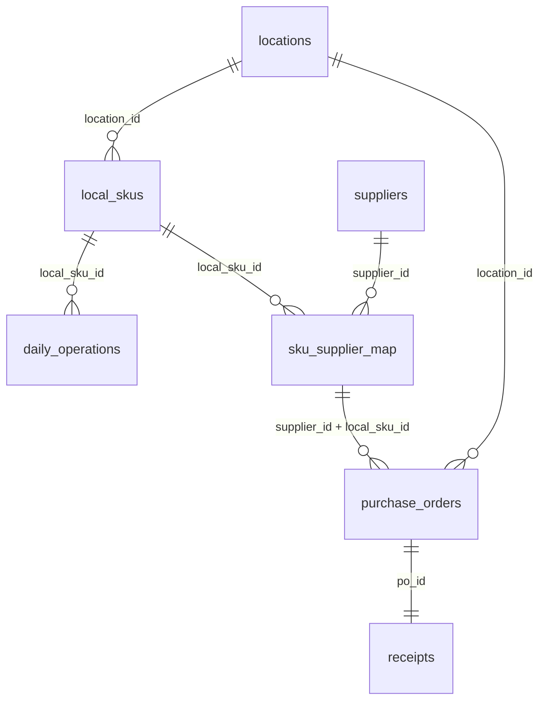

# Phase 3 — NOVAMART ERP data preparation

**Status:** Data engineering complete; awaiting Phase 3 approval. The Kaggle base is **published synthetic data**. The supplier and procurement layers are **additional NOVAMART simulations**. None of these transactions represent a real business.

## Why the local SKU key matters

The published `Product ID` has different categories in different stores. A product dimension keyed only on `Product ID` would assign incompatible categories. We use `local_sku_id = original_store_id + "_" + original_product_id` (for example, `S001_P0001`). Each local SKU belongs to one store/location and has one category. This creates 100 local SKUs from 5 stores × 20 source product IDs; it intentionally does not assert that the same product ID denotes the same item across stores. Stores serve as replenishment locations for this scenario.

## Cleaning and derived fields

`src/build_phase3.py` reads the original ZIP without changing it. It checks exact source columns, missing values, exact and grain-key duplicates, ID formats, numeric nonnegativity, positive prices, discount range, binary flags, store-region stability, and local SKU-category stability. It parses dates, renames columns to snake_case, sorts chronologically by date/location/SKU, and writes the daily table. **No source rows were removed, capped, or imputed.** `Demand` remains `estimated_demand_source`, never verified customer orders. `Units Ordered` remains `units_ordered_source`, never a matched purchase order or receipt.

Only calendar fields are derived now: `year`, `quarter`, `month`, `month_name`, ISO `week_of_year`, Monday=0 `day_of_week`, `day_name`, `is_weekend`. No target lags, rolling forecasting features, or models were created. Source inventory timing is not documented, so a same-day inventory snapshot is used only as a scenario decision input, with that uncertainty disclosed.

## Tables and lineage

| Output | Rows | Key and origin | Notes |
| --- | ---: | --- | --- |
| `locations.csv` | 5 | `location_id`; SOURCE IDs/region + DERIVED name | Original store IDs preserved |
| `local_skus.csv` | 100 | `local_sku_id`; DERIVED key from SOURCE IDs and category | `location_id` FK |
| `daily_operations.csv` | 76,000 | `(date, local_sku_id)`; SOURCE synthetic observations + DERIVED keys/calendar | `location_id`, `local_sku_id` FKs; provenance label |
| `suppliers.csv` | 6 | `supplier_id`; SIMULATED | Assumed lead time, variation, unit-cost factor, fulfillment probability |
| `sku_supplier_map.csv` | 100 | `(local_sku_id, supplier_id)`; SIMULATED | One primary source per local SKU; unit cost based on first observed listed price |
| `purchase_orders.csv` | 5,299 | `po_id`; SIMULATED | One SKU per PO; supplier/SKU/location FKs |
| `receipts.csv` | 5,299 | `receipt_id`; SIMULATED | One simulated receipt per PO; `po_id` unique FK |

The per-table row counts and SHA-256 hashes are recorded in `data/processed/phase3_manifest.json`. `data_origin` marks mixed source-derived facts and simulated supplier/procurement outputs. The raw source itself is synthetic according to its publisher. `discount_source` is retained as given; no assumption about realized net revenue is made.



`purchase_orders` also checks that its location matches the location of its local SKU. These are prepared CSV tables; creating and analyzing the SQLite database belongs to Phase 4.

## Supplier and procurement simulation methodology

- Seed `31027` for the NumPy random generator. Six fictional suppliers have fixed region, base lead time (5–11 days), lead-time variation (1–2.5 days), unit-cost factor (0.59–0.69), and probability of full quantity delivery (0.88–0.97). These are **scenario parameters**, not supplier scores or empirical reliability.
- Sorted local SKUs are assigned cyclically to one primary supplier each. Expected lead time comes from that supplier. Procurement unit cost is first-day listed price × assumed supplier cost factor, rounded to cents. This initial price is known before the first simulated order; the publisher gives no actual costs or currency.
- Every 14th day after a 28-day warmup, the simulation checks the **preceding** 28 days of `units_sold`, excluding the decision day. It proposes `max(0, ceil(21 × prior mean daily sales − current inventory snapshot))` units. Zero proposals create no PO. The 21-day coverage rule is a simple scenario policy, not an optimized reorder point. No future sales or publisher-estimated demand influences order creation.
- Expected delivery is order date + supplier base lead time. Actual transit is base lead time plus a rounded seeded normal variation, floored at one day. A separate seeded draw determines full versus partial quantity; partial receipts are 75–99% of ordered quantity rounded down. One receipt records the outcome; no extra backorder or follow-up receipt is invented. Some receipts can fall after the final date of the source observations.
- Status values describe the simulated receipt outcome. Supplier performance KPIs may later be computed from these events, but they cannot measure real suppliers. Simulated orders are independently generated and are **not** the publisher's `Units Ordered` field.

## Inventory consistency and limitations

The source offers daily inventory snapshots and restocking quantities without purchase-order IDs, receipts, adjustment events, or snapshot timing. The snapshots do not reconcile reliably from prior stock, sales, and source units ordered. The additional simulated POs/receipts therefore **do not reconcile to or modify historical inventory**. Later inventory optimization must treat on-hand source values and simulated lead times as a scenario combination, not a historically balanced ERP ledger. Observed sales may be constrained by available stock; the publisher's estimated `Demand` is not ground truth and was less than Units Sold on 21,000 Phase 2 rows. Product equivalence across stores is unresolved. Listed price is not verified revenue or currency.

## Validation and reproducibility

Run from the repository root:

```bash
python src/build_phase3.py
python src/validate_phase3.py
```

Validation checks uniqueness of all primary keys, full foreign-key membership, stable store/SKU/category mappings, 760 daily records per local SKU, chronological daily ordering, nonmissing daily fields, positive PO cost and quantity, expected and actual delivery not before order, received quantity between zero and ordered, exactly one primary supplier per SKU, consistent simulated lineage, and byte-identical generated CSVs on a second build with the same seed. It stops on failure. The full pass is recorded by the command output; counts and hashes are in the manifest. This is a validation of **internal structure**, not evidence that generated transactions match historical reality.

## Phase 4 gate

Phase 4 may create a SQLite database and analyze these tables only after approval. Preserve source-versus-simulated labels in every SQL view/report, and never join the simulated receipt events as if they explain historical source inventory changes.
