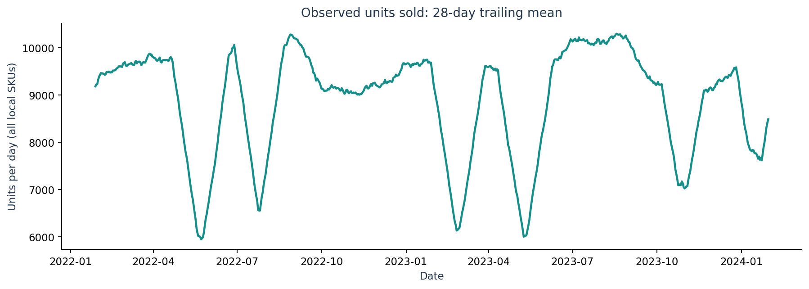
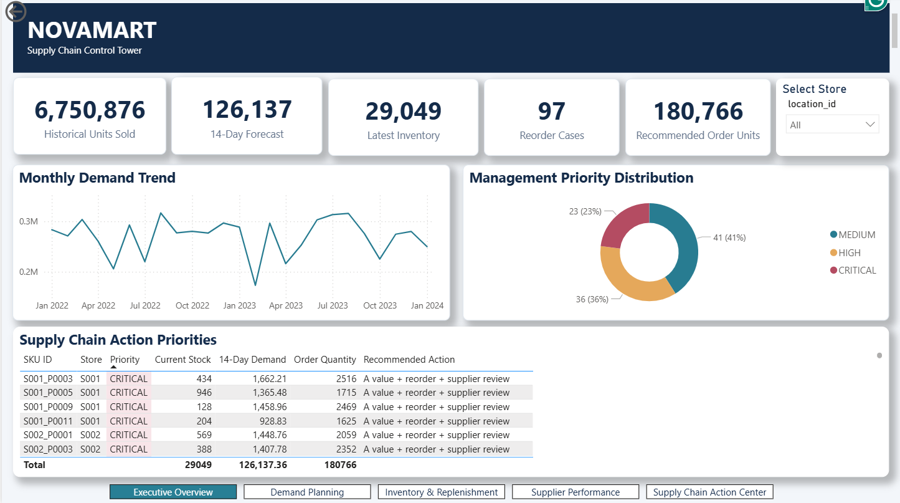
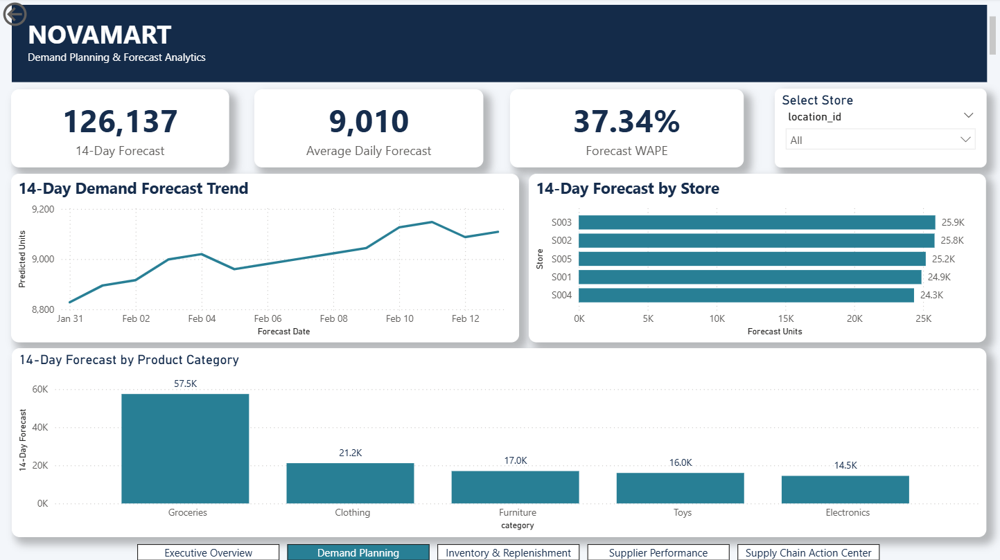
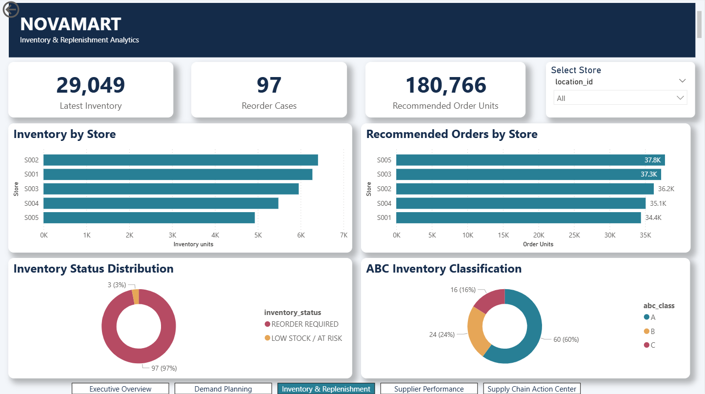
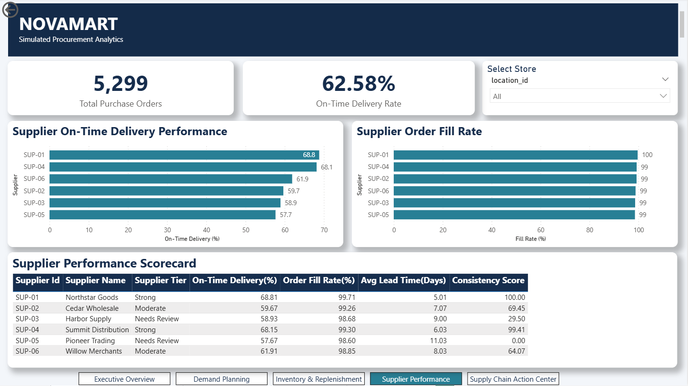
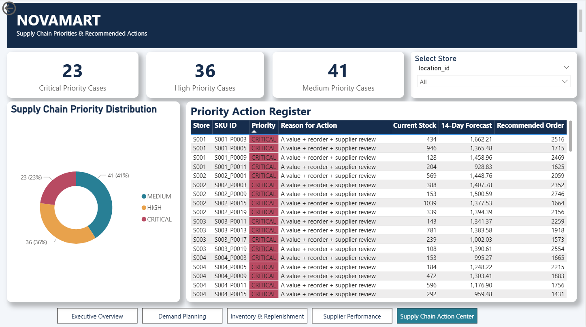

# NOVAMART
## Supply Chain Intelligence Platform

**Transforming retail data into actionable supply chain decisions**

**Project Type:** End-to-End Business Analytics & Supply Chain Intelligence  
**Tools:** Python, SQL, SQLite, scikit-learn, Power BI, DAX  
**Data:** 76,000 synthetic daily retail records | 5 stores | 100 store-specific SKUs

### Project Overview

NOVAMART is an end-to-end supply chain analytics portfolio project designed to help a fictional retail business understand historical sales, forecast near-term sales, evaluate inventory replenishment needs, and prioritize supplier-related operational risks.

The platform combines data preparation, relational SQL analysis, exploratory data analysis, machine learning, inventory planning, ABC classification, simulated supplier performance evaluation, and interactive Power BI reporting.

The final deliverable is a five-page Supply Chain Control Tower that connects analytical outputs to management review and decision-making.

### The Business Problem

Retail supply chains face interconnected challenges: fluctuating sales, limited inventory visibility, replenishment uncertainty, and supplier delivery variability.

For NOVAMART, the central challenge was to bring these decision areas together into one analytical workflow.

The project explores five business questions:

1. How are sales and inventory distributed across stores and products?
2. How accurately can historical sales be forecast over the next 14 days?
3. Which products require replenishment review, and what quantities could be proposed?
4. Which products and simulated suppliers deserve greater management attention?
5. How can these insights be communicated through an interactive business intelligence dashboard?

### My Approach

I developed the project across nine phases, beginning with dataset validation and ending with an interactive Power BI dashboard.

The workflow connects historical retail observations to forecasting models, scenario-based inventory recommendations, supplier performance analysis, and management-priority reporting.

The goal was not simply to generate predictions, but to create a reproducible analytical system that supports clearer operational decisions.

> **Data transparency:** NOVAMART uses a publicly available synthetic retail dataset. Supplier transactions and procurement scenarios were simulated separately. Forecasts and replenishment recommendations are analytical outputs, not actual business transactions or measured financial savings.

---

## Business Objectives & Success Measures

### Business Objectives

NOVAMART was designed around five analytical objectives:

| Objective | Business Question | Analytical Deliverable |
| --- | --- | --- |
| Sales Visibility | Which stores and products contribute the most to historical sales? | Sales trends, SKU-level analysis, and store comparisons |
| Demand Planning | How accurately can near-term sales be predicted? | 14-day sales forecasting model and baseline comparison |
| Inventory Planning | Which SKUs need replenishment review? | Reorder points, safety stock, and proposed order quantities |
| Supplier Evaluation | Which simulated suppliers present greater delivery risk? | Supplier scorecards and delivery-performance analysis |
| Decision Prioritization | Which supply chain cases deserve management attention first? | ABC classification, priority rules, and Power BI action center |

### How I Evaluated Success

Rather than claiming financial savings that were not observed, I evaluated the project through analytical accuracy, reproducibility, operational visibility, and decision support.

**1. Forecast Accuracy**

Compared multiple forecasting approaches using chronological validation and held-out test data.

The selected Ridge Regression model achieved:

- Test WAPE: 37.34%
- Test MAE: 32.56 units
- Test RMSE: 41.17 units
- 28-day moving-average baseline test WAPE: 37.69%

The selected model improved test WAPE by 0.35 percentage points over the baseline. This is a modest improvement, not evidence of a major forecasting breakthrough.

**2. Inventory Decision Support**

Applied a scenario-based replenishment policy using forecast sales rates, assumed supplier lead times, safety stock, and reorder points.

The analysis identified:

- 97 of 100 SKUs requiring replenishment review
- 180,766 units in proposed replenishment quantities

These figures represent model-generated recommendations, not executed purchase orders.

**3. Product and Supplier Prioritization**

Used ABC classification and simulated supplier scorecards to distinguish higher-priority operational review cases.

Results included:

- 60 Class A SKUs, 24 Class B SKUs, and 16 Class C SKUs
- 23 Critical, 36 High, and 41 Medium management-priority cases
- Six simulated suppliers evaluated using delivery and fulfillment metrics

**4. Business Intelligence Delivery**

Created a five-page Power BI Supply Chain Control Tower to consolidate sales, forecasting, inventory, supplier performance, and management priorities into one reporting experience.

**5. Reproducibility**

Organized the workflow into documented Python scripts, SQL queries, saved model artifacts, validation outputs, and dashboard-ready datasets.

The project was validated locally using the approved saved forecasting model without retraining it.

### Definition of Project Success

For this portfolio case study, success means producing a transparent, reproducible analytical workflow that helps users identify issues, compare alternatives, and prioritize supply chain decisions.

It does not mean proving actual cost savings, service-level improvements, or supplier performance changes, because those outcomes were not measured in a live business environment.

---

## Data Understanding & Preparation

### Dataset Overview

NOVAMART uses the publicly available **Retail Store Inventory and Demand Forecasting** dataset published by atomicd on Kaggle.

The dataset contains synthetic retail observations across five stores and twenty product identifiers per store.

| Dataset Characteristic | Value |
| --- | --- |
| Historical period | January 1, 2022 – January 30, 2024 |
| Stores | 5 |
| Store-specific SKUs | 100 |
| Daily observations | 76,000 |
| Historical dates | 760 |
| Original dataset columns | 16 |
| Data type | Synthetic retail inventory and sales data |

**Source:** [Retail Store Inventory and Demand Forecasting — Kaggle](https://www.kaggle.com/datasets/atomicd/retail-store-inventory-and-demand-forecasting)

### Data Validation

Before modeling, I examined the dataset's structure, date coverage, product identifiers, and business meaning.

One important discovery was that product identifiers were reused across stores, sometimes with different category assignments.

To avoid incorrectly combining unrelated store-product records, I created a store-specific SKU identifier.

For example:

`S001_P0001`

This identifier represents a particular product within a particular store and serves as the consistent SKU-level key throughout the analytical workflow.

### Understanding the Data's Limitations

The dataset includes recorded units sold, inventory levels, and a publisher-provided demand estimate.

However, the demand field should not be interpreted as verified unconstrained customer demand. In some observations, recorded units sold exceed that estimate.

For forecasting, I therefore used historical `units_sold` as the prediction target.

I also avoided treating the source inventory and order fields as a fully reconciled transaction ledger because their historical movements could not be reliably reconstructed from the available columns.

These decisions helped prevent unsupported business interpretations.

### Relational Data Model

I transformed the source dataset into an ERP-style analytical structure with seven tables.

| Table | Purpose |
| --- | --- |
| `locations` | Store reference information |
| `local_skus` | Store-specific product information |
| `daily_operations` | Historical daily sales and inventory observations |
| `suppliers` | Simulated supplier master data |
| `sku_supplier_map` | Simulated relationships between SKUs and suppliers |
| `purchase_orders` | Simulated procurement orders |
| `receipts` | Simulated purchase-order receipts |

The resulting model separates retail operations from supplier and procurement scenarios.

### Simulated Procurement Data

The original retail dataset does not contain a complete, verifiable supplier transaction history.

To demonstrate procurement analytics, I generated a separate simulated scenario containing:

- Six fictional suppliers
- Supplier assignments for 100 store-specific SKUs
- 5,299 simulated purchase orders
- 5,299 associated receipt records
- Simulated lead times, delivery delays, and fulfillment quantities

These records support supplier-performance analysis but are not historical transactions from the original dataset.

They also do not reconcile directly to the source inventory balances.

### Data Preparation Workflow

The preparation process followed these stages:

1. Validate source columns, dates, and record counts.
2. Create consistent store-specific SKU identifiers.
3. Build reference tables for stores and SKUs.
4. Prepare the daily operations fact table.
5. Generate separately simulated procurement records.
6. Load the relational tables into SQLite.
7. Validate record counts, key relationships, and analytical outputs.
8. Export curated datasets for forecasting, inventory analysis, supplier evaluation, and Power BI.

### Why This Matters

The most important part of this phase was establishing a trustworthy interpretation of the available data.

By separating observed retail records from simulated procurement scenarios and using consistent SKU identifiers, I created a foundation for reproducible analysis without presenting synthetic business assumptions as verified operational facts.

---

## SQL & Exploratory Data Analysis

### Analytical Objective

After preparing the relational data model, I used SQL and Python to investigate historical sales performance, inventory availability, product behavior, and simulated procurement operations.

The objective was to understand the business context before developing forecasting and replenishment recommendations.

### SQL Analysis

I used SQLite to organize the analytical tables and developed reusable SQL queries covering five areas:

| Analysis | Business Purpose |
| --- | --- |
| Demand Summary | Compare historical sales across stores, products, and categories |
| Inventory Summary | Evaluate stock levels and inventory coverage |
| Procurement Summary | Analyze simulated purchase orders and receipts |
| Supplier Performance | Compare simulated supplier delivery and fulfillment metrics |
| Supply Chain Exceptions | Identify operational cases requiring further investigation |

The SQL workflow also included integrity checks to verify relationships between the prepared tables.

These queries provided structured outputs for subsequent Python analysis and reporting.

### Exploratory Data Analysis

Using Python, pandas, and Matplotlib, I investigated historical patterns across stores, categories, products, promotions, and inventory.

#### 1. Historical Sales Performance

The dataset recorded **6,750,876 units sold** across the five stores during the historical observation period.

The analysis revealed differences in sales volume across locations and product categories.

For example:

- Store S002 recorded 1,386,126 units sold.
- Store S004 recorded 1,308,191 units sold.
- The Groceries category accounted for 3,127,335 units sold.

These findings helped establish which areas contributed most to recorded sales activity.

#### 2. Product-Level Variation

Sales behavior varied across store-specific SKUs.

The ten highest-volume SKUs accounted for approximately **12.04% of total recorded units sold**.

I also examined daily sales variability to understand why a single replenishment assumption would not be equally appropriate for every product.

#### 3. Inventory Availability

The latest historical inventory snapshot, dated January 30, 2024, contained **29,049 units** across the 100 store-specific SKUs.

A descriptive seven-day coverage screen identified **90 SKUs below seven days of estimated coverage**.

This was an exploratory inventory indicator, not the final replenishment policy.

The dataset also contained 406 SKU-day observations where recorded sales and inventory were both zero.

These observations highlight potential availability-related limitations, but do not independently prove lost sales or unmet demand.

#### 4. Promotions and Sales

Promotional observations had higher average recorded sales than non-promotional observations:

- Promotional observations: 103.10 units
- Non-promotional observations: 81.83 units

This is an observed association, not proof that promotions caused the difference.

Other factors, including product mix, seasonality, and inventory availability, may also influence the results.

#### 5. Simulated Procurement Performance

The simulated procurement dataset contained **5,299 purchase orders and associated receipts**.

Of these, 3,316 receipts were classified as on time, representing an overall simulated on-time rate of approximately **62.58%**.

These results were used to demonstrate supplier evaluation and operational exception reporting.

They should not be interpreted as real supplier performance.

### Key Insights

The exploratory analysis established several important considerations:

1. Historical sales activity differs across stores, categories, and SKUs.
2. Inventory coverage varies substantially across products.
3. Recorded sales may be influenced by stock availability.
4. Promotional and non-promotional observations show different average sales levels, without establishing causality.
5. Simulated supplier delivery performance provides a useful scenario for prioritization and reporting.

### Business Implications

These findings informed the later phases of NOVAMART.

Historical sales patterns supported feature development for demand forecasting. Inventory coverage motivated the replenishment analysis. Simulated procurement performance provided the basis for supplier scorecards.

Most importantly, the analysis demonstrated why supply chain decisions benefit from combining multiple perspectives rather than relying on a single sales or inventory metric.

---

## Demand Forecasting — Predicting the Next 14 Days

### Business Objective

Inventory planning requires an estimate of future sales so that replenishment decisions can be made before stock becomes insufficient.

I developed a 14-day sales forecasting workflow for 100 store-specific SKUs, using historical sales and other information available at each forecast origin.

The forecasting target was recorded `units_sold`, rather than the publisher-provided demand estimate.

### Forecasting Approach

The workflow used a pooled forecasting model trained across all 100 store-specific SKUs.

Features included:

- Historical sales patterns from a 28-day lookback window
- Calendar-related information
- Store and product identifiers
- Product category information

The forecasting process generated predictions for each SKU over a 14-day horizon.

### Model Comparison

I evaluated three simple forecasting baselines alongside two machine learning approaches:

1. Last-observation baseline
2. Seven-day moving-average baseline
3. Twenty-eight-day moving-average baseline
4. Ridge Regression
5. Histogram-based Gradient Boosting

I used chronological training, validation, and test periods to reduce the risk of evaluating the models on information from the future.

Model selection was based on validation performance before reviewing held-out test results.

### Held-Out Test Results

| Model | Test WAPE |
| --- | ---: |
| Last-observation baseline | 49.25% |
| Seven-day moving average | 40.74% |
| Twenty-eight-day moving average | 37.69% |
| Ridge Regression | **37.34%** |
| Histogram-based Gradient Boosting | 37.47% |

Ridge Regression was selected using a predefined simplicity rule: it was within one percentage point of the best validation WAPE while offering a simpler model.

On the held-out test set, Ridge achieved:

- WAPE: 37.34%
- MAE: 32.56 units
- RMSE: 41.17 units

Its test WAPE was 0.35 percentage points lower than the 28-day moving-average baseline.

This modest improvement demonstrates the importance of comparing machine learning models with practical baselines rather than assuming that more complex models will always perform better.

### Final 14-Day Forecast

After evaluation, the selected Ridge model was refitted using the approved historical training data through January 30, 2024.

It generated forecasts for January 31 through February 13, 2024.

| Forecast Output | Value |
| --- | ---: |
| Forecast horizon | 14 days |
| Store-specific SKUs | 100 |
| SKU-day predictions | 1,400 |
| Total predicted units sold | 126,137.36 |

These predictions are historical scenario outputs generated from the dataset's final observation date, not current or live retail forecasts.

### Business Application

The 14-day forecast provided a consistent analytical input for the inventory replenishment phase.

By converting SKU-level predictions into estimated daily sales rates, the project could calculate lead-time demand, safety stock, reorder points, and proposed replenishment quantities.

### Limitations

The model predicts recorded sales rather than verified unconstrained customer demand.

Stock availability may influence recorded sales, and the model does not independently estimate lost sales.

Forecast accuracy was evaluated on historical held-out data. The project does not claim production deployment, calibrated prediction intervals, or measured improvements in real-world inventory outcomes.

---

## Inventory Optimization & Replenishment

### Business Objective

Forecasting future sales is only one part of inventory planning.

The next challenge is determining which products require replenishment review, how much inventory should be held as a buffer, and what order quantities could be proposed.

I developed a scenario-based inventory replenishment framework for 100 store-specific SKUs using the selected 14-day sales forecast.

### Inventory Planning Methodology

The framework combined five analytical components:

| Component | Purpose |
| --- | --- |
| Forecast Daily Sales Rate | Estimate expected daily sales from the 14-day forecast |
| Lead-Time Demand | Estimate sales during assumed supplier lead time |
| Safety Stock | Provide a statistical buffer for historical forecast variability |
| Reorder Point | Identify when inventory reaches a replenishment threshold |
| Target Stock | Calculate a proposed inventory level covering lead time and the review period |

The model used simulated supplier lead times and a 14-day inventory review period.

### Replenishment Logic

**1. Forecast Daily Sales Rate**

Calculated as the total 14-day forecast divided by 14.

**2. Lead-Time Demand**

Calculated by multiplying forecast daily sales by the simulated supplier lead time.

**3. Safety Stock**

Estimated using historical out-of-sample forecast error variability, the square root of assumed lead time, and a 1.645 statistical multiplier.

This is a planning assumption, not a validated 95% service-level guarantee.

**4. Reorder Point**

Reorder Point = Lead-Time Demand + Safety Stock

**5. Proposed Order Quantity**

When current inventory was at or below the reorder point, the model calculated the difference between target stock and current inventory, rounded up to whole units.

Otherwise, the proposed order quantity was zero.

### Inventory Planning Results

The scenario-based analysis produced the following results:

| Metric | Result |
| --- | ---: |
| SKUs evaluated | 100 |
| SKUs flagged for replenishment | 97 |
| SKUs not triggering the reorder policy | 3 |
| Total proposed order quantity | 180,766 units |
| Average safety stock | 175.48 units |
| Average economic order quantity (EOQ) | 891.53 units |
| Average estimated inventory coverage | 3.27 days |

The proposed quantities are analytical recommendations, not actual purchase orders.

### Example SKU Decision

For store-specific SKU `S001_P0001`:

| Metric | Value |
| --- | ---: |
| Forecast daily sales | 87.43 units |
| Assumed lead time | 5 days |
| Current inventory | 383 units |
| Safety stock | 129.66 units |
| Reorder point | 566.82 units |
| Target stock | 1,790.87 units |
| Proposed order quantity | 1,408 units |

Because current inventory was below the reorder point, the model recommended replenishment review.

This example illustrates how a sales forecast can be translated into a concrete inventory planning recommendation.

### Economic Order Quantity Analysis

I also calculated an illustrative Economic Order Quantity (EOQ) using annualized forecast sales, assumed ordering cost, and assumed annual inventory holding cost.

EOQ provided a comparison point for replenishment quantities, rather than an automatically executed ordering decision.

Sensitivity analysis was used to examine how changes in cost assumptions affected the EOQ calculation.

### Business Implications

The replenishment framework helped:

1. Identify SKUs that met the defined reorder conditions.
2. Estimate safety stock and target inventory levels.
3. Generate consistent proposed replenishment quantities.
4. Compare inventory planning assumptions across products.
5. Provide SKU-level recommendations for management review.

### Limitations

The model used the latest observed inventory balance as a proxy for available inventory position.

It did not incorporate verified open purchase orders, allocated inventory, backorders, warehouse capacity, or purchasing constraints.

Supplier lead times and cost assumptions were simulated.

As a result, recommendations should be treated as planning scenarios requiring business validation before implementation.

The project does not claim measured stockout reductions, cost savings, or improved service levels.

---

## ABC Classification & Supplier Performance Analysis

### Business Objective

Not all products and suppliers require the same level of management attention.

I developed an analytical prioritization framework combining product value, replenishment requirements, and simulated supplier performance.

The goal was to identify which store-specific SKUs deserved the greatest attention in a supply chain management review.

### ABC Inventory Classification

I applied ABC analysis to 2023 historical sales using a sales-value proxy:

Sales Value = Units Sold × Listed Unit Price

Products were ranked by their contribution to total calculated sales value and assigned to ABC classes based on cumulative value.

### ABC Analysis Results

| ABC Class | Number of SKUs | Share of Calculated Sales Value |
| --- | ---: | ---: |
| A | 60 | 80.88% |
| B | 24 | 14.51% |
| C | 16 | 4.61% |
| **Total** | **100** | **100%** |

Class A products accounted for most of the calculated sales value, making them especially important for inventory review.

The analysis used listed prices as a value proxy rather than verified realized revenue.

### Simulated Supplier Performance

The original dataset did not provide a complete supplier transaction history.

To demonstrate procurement analytics, I evaluated six fictional suppliers using separately simulated purchase-order and receipt records.

The supplier analysis examined:

- On-time delivery performance
- Order fill rates
- Delivery consistency
- Delivery delays

Across the simulated procurement scenario, 3,316 of 5,299 receipts were classified as on time, representing approximately 62.58%.

### Supplier Scorecard Methodology

I created a weighted supplier scorecard using four normalized performance components.

| Performance Component | Weight |
| --- | ---: |
| On-time delivery | 40% |
| Fill rate | 30% |
| Delivery consistency | 20% |
| Delay performance | 10% |

The component metrics were normalized relative to the six suppliers before applying the weights.

As a result, scorecard values represent relative performance within the simulated supplier group, not absolute percentages of supplier quality.

### Supplier Scorecard Results

| Supplier | Relative Score | Performance Tier |
| --- | ---: | --- |
| SUP-01 — Northstar | 100.00 | Strong |
| SUP-04 — Summit | 86.41 | Strong |
| SUP-02 — Cedar | 45.35 | Moderate |
| SUP-06 — Willow | 41.36 | Moderate |
| SUP-03 — Harbor | 15.66 | Needs Review |
| SUP-05 — Pioneer | 0.00 | Needs Review |

The scores identify relative differences within this simulated scenario.

For example, a score of 100 does not mean that a supplier delivered every order on time.

### Supply Chain Priority Framework

I combined ABC classification, replenishment flags, and simulated supplier performance tiers to create management-priority categories.

The resulting classifications were:

| Priority | Number of SKUs |
| --- | ---: |
| Critical | 23 |
| High | 36 |
| Medium | 41 |
| Routine | 0 |
| **Total** | **100** |

The framework identified **59 Critical or High priority cases** for management review.

These are rule-based classifications, not observed operational incidents.

### Business Implications

The combined analysis provides a structured way to:

1. Prioritize higher-value products.
2. Identify replenishment cases associated with weaker simulated suppliers.
3. Compare suppliers using consistent performance measures.
4. Focus management review on the most important SKU-level scenarios.
5. Support purchasing and inventory discussions through an integrated priority framework.

### Limitations

ABC classification was based on historical calculated sales value rather than verified revenue or profitability.

Supplier performance was derived entirely from simulated procurement records.

The supplier scores were relative to the six fictional suppliers and should not be interpreted as independently validated risk ratings.

The priority categories are scenario-based decision-support outputs. They do not establish actual supplier failures, financial losses, or operational improvements.

---

## Power BI Supply Chain Control Tower

### Dashboard Overview

I designed and built a five-page interactive Power BI dashboard to bring together historical retail operations, sales forecasting, inventory planning, simulated supplier performance, and management-priority recommendations.

The dashboard serves as the presentation layer of NOVAMART, transforming analytical outputs into an accessible decision-support experience.

### Page 1 — Executive Overview

**Business question:** What is the overall state of the retail supply chain?

The Executive Overview provides a high-level summary of historical sales, inventory conditions, and key operational indicators.

It enables users to explore performance across stores and products before investigating specific supply chain issues.

### Page 2 — Demand Planning

**Business question:** What do historical sales patterns and model forecasts suggest about near-term sales?

This page presents historical sales information alongside the approved 14-day forecasting outputs.

It helps users examine demand patterns and compare forecast-related metrics.

The forecasting results relate to the historical period ending January 30, 2024, rather than live business activity.

### Page 3 — Inventory & Replenishment

**Business question:** Which SKUs meet the replenishment policy's review conditions?

This page presents inventory planning indicators, reorder flags, safety stock, and proposed replenishment quantities.

The scenario-based policy flagged 97 of 100 SKUs and proposed 180,766 total order units.

These recommendations are planning outputs, not executed purchase orders.

### Page 4 — Supplier Performance

**Business question:** How do the six simulated suppliers compare?

The Supplier Performance page uses simulated procurement records to explore delivery performance, fulfillment, and relative supplier scorecards.

The analysis supports comparisons among fictional suppliers without presenting their metrics as actual vendor performance.

### Page 5 — Supply Chain Action Center

**Business question:** Which supply chain cases should management review first?

The Action Center combines ABC classification, replenishment status, and simulated supplier-performance tiers into rule-based priority categories.

It highlights 23 Critical, 36 High, and 41 Medium cases, helping users focus on higher-priority analytical scenarios.

### Dashboard Design Approach

The dashboard was designed around three principles:

1. **Business-first navigation:** Organize information by operational decision area rather than by technical processing phase.
2. **Consistent analytical definitions:** Use prepared data tables and documented measures to maintain consistency across pages.
3. **Transparent interpretation:** Distinguish historical retail observations, model forecasts, and simulated procurement scenarios.

### Technical Implementation

The Power BI reporting layer uses 14 prepared CSV datasets, including a calendar table, with documented relationships and DAX measures.

The dashboard was developed in Power BI Desktop and saved as a local `.pbix` file.

Five dashboard screenshots are included in the GitHub repository for portfolio viewing.

The editable Power BI Desktop file is maintained separately and is not currently distributed through the public repository.

### Business Value

The Control Tower brings several analytical workflows into one reporting experience.

Instead of reviewing separate SQL outputs, Python results, and supplier scorecards, a user can navigate between executive performance, forecasting, inventory planning, supplier analysis, and management priorities.

The dashboard demonstrates how technical analytics can be translated into structured business decision support.

---

## Challenges, Lessons Learned & Future Improvements

### Key Technical Challenges

#### 1. Resolving Product Identifier Ambiguity

**Challenge:** Product identifiers were reused across stores, and some had different category assignments.

**Solution:** Created store-specific SKU identifiers to maintain consistent relationships across the analytical tables.

**Lesson:** Understanding data granularity and business keys is essential before building analytical models.

#### 2. Distinguishing Observed Data from Simulated Scenarios

**Challenge:** The source dataset did not contain a complete, reconcilable procurement history.

**Solution:** Built a separate simulated procurement scenario and explicitly distinguished simulated purchase orders, receipts, suppliers, and lead times from historical retail observations.

**Lesson:** Analytics must communicate the difference between source evidence, assumptions, and modeled outputs.

#### 3. Selecting a Forecasting Model

**Challenge:** More complex forecasting methods did not necessarily provide meaningful improvements over simpler alternatives.

**Solution:** Compared multiple baselines and machine learning models using chronological validation and held-out testing.

Selected Ridge Regression using a predefined simplicity rule based on validation results.

**Lesson:** Model selection should balance predictive performance, reproducibility, and complexity rather than focusing only on sophisticated algorithms.

#### 4. Translating Forecasts into Inventory Decisions

**Challenge:** Sales predictions alone do not directly answer when or how much to reorder.

**Solution:** Developed a replenishment framework combining forecast daily sales, simulated supplier lead times, safety stock, reorder points, and target inventory.

**Lesson:** Analytical models become more useful when their outputs connect to clearly defined business decisions.

#### 5. Integrating Multiple Analytical Workflows

**Challenge:** Historical sales, forecasts, inventory recommendations, and simulated supplier metrics have different meanings and time references.

**Solution:** Prepared separate reporting datasets, documented relationships and measures, and organized the Power BI dashboard around five business decision areas.

**Lesson:** Effective business intelligence requires consistent metric definitions and clear communication of analytical assumptions.

### What I Learned

This project strengthened my experience in:

- Designing relational data models and reusable SQL analysis
- Building reproducible Python data pipelines
- Evaluating machine learning models using time-based validation
- Translating forecasts into scenario-based inventory recommendations
- Developing ABC classification and supplier performance scorecards
- Designing Power BI dashboards for business decision support
- Documenting data limitations and communicating analytical results responsibly

### Future Improvements

If NOVAMART were extended into a production-oriented system, I would prioritize the following enhancements.

**1. Incorporate Actual Operational Data**

Integrate verified purchase orders, receipts, inventory movements, open orders, and supplier contracts.

This would support inventory reconciliation and more realistic purchasing decisions.

**2. Improve Demand Estimation**

Explore methods for estimating demand when recorded sales are constrained by stock availability.

Evaluate additional forecasting methods and prediction uncertainty using appropriate historical backtesting.

**3. Validate Inventory Policies**

Test replenishment recommendations through historical simulations that include inventory movements, purchasing constraints, lead-time variability, and service-level objectives.

Compare alternative policies using measured outcomes such as stockouts, holding costs, and fill rates.

**4. Expand Supplier Analytics**

Replace simulated procurement records with actual supplier transactions.

Introduce supplier performance monitoring, exception alerts, and more robust risk indicators.

**5. Automate Reporting**

Develop scheduled data refreshes, validation checks, and automated reporting workflows.

This would move the platform closer to an operational analytics environment.

### Final Reflection

NOVAMART demonstrates my ability to connect data engineering, SQL analytics, machine learning, inventory planning, and business intelligence into one end-to-end analytical workflow.

The most valuable outcome was not a single forecast or dashboard metric, but the development of a reproducible decision-support framework that makes assumptions explicit and connects technical analysis to business questions.

---

## Project Summary

NOVAMART is an end-to-end supply chain intelligence platform developed to demonstrate how historical retail data can support forecasting, inventory planning, supplier evaluation, and business intelligence.

The project combines Python, SQL, machine learning, scenario-based optimization, and Power BI into a documented analytical workflow.

### Project at a Glance

| Category | Highlight |
| --- | --- |
| Dataset | 76,000 synthetic retail records |
| Business Scope | 5 stores and 100 store-specific SKUs |
| Database | SQLite relational model with 7 tables |
| Forecasting | 14-day Ridge Regression sales forecast |
| Forecast Accuracy | 37.34% held-out test WAPE |
| Inventory Analysis | 97 SKUs flagged for replenishment review |
| Replenishment Scenario | 180,766 proposed order units |
| Supplier Analysis | 6 simulated suppliers |
| Prioritization | 59 Critical or High priority cases |
| Visualization | 5-page interactive Power BI dashboard |

### Skills Demonstrated

**Data Analytics:** Data validation, exploratory data analysis, KPI development, business interpretation

**SQL & Data Modeling:** Relational schema design, SQL queries, data integrity checks

**Python & Machine Learning:** pandas, scikit-learn, chronological model evaluation, forecasting pipelines

**Supply Chain Analytics:** Inventory coverage, safety stock, reorder points, EOQ, ABC classification, supplier scorecards

**Business Intelligence:** Power BI, DAX, dashboard design, analytical storytelling

### Explore the Project

**GitHub Repository:**  
https://github.com/tejuvarma2003/NOVAMART-Supply-Chain-Intelligence

**Power BI Dashboard:**  
Five dashboard screenshots are available in the GitHub repository under `dashboard/screenshots/`.

**Source Code & Documentation:**  
The repository contains Python scripts, SQL analysis, model artifacts, validation outputs, and project documentation.

### Closing Statement

NOVAMART reflects my approach to analytics: understand the business problem, validate the data, compare analytical methods, translate findings into practical recommendations, and communicate results through clear reporting.

The project demonstrates an end-to-end analytical workflow while explicitly distinguishing observed data, simulated scenarios, and model-generated recommendations.
